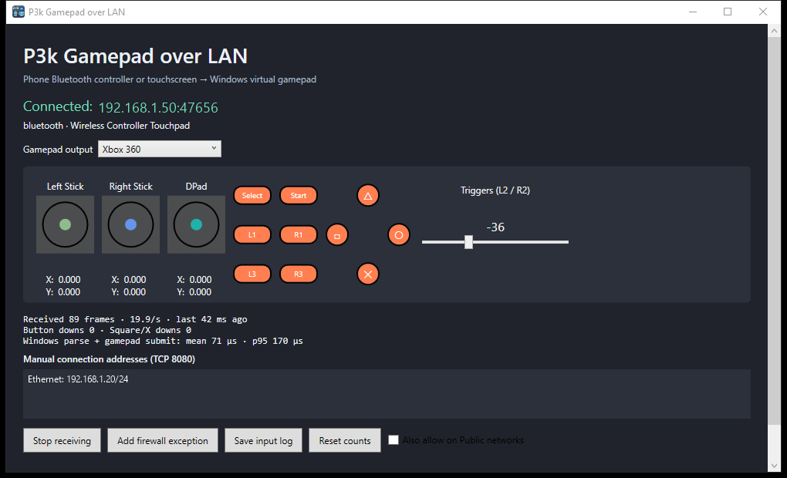
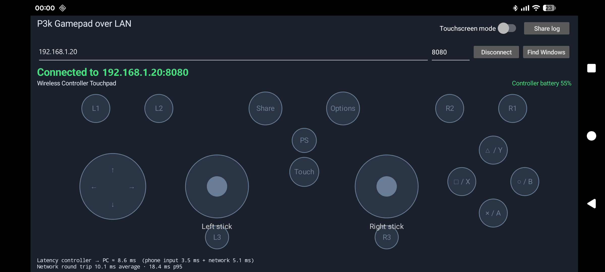

# P3k Bluetooth GamePad Over LAN

Use an Android phone as a low-latency bridge between a Bluetooth controller and a Windows PC, or as a touchscreen
gamepad. The phone forwards input over your local network, and the Windows app presents it to games as a virtual
Xbox 360 or DualShock 4 controller.

It was built for a PC whose Bluetooth adapter delivered controller reports only every 60 ms (16.7 Hz) and lost quick
presses. Routed through a phone, the same controller reports every 11.25 ms.

| Windows receiver | Android sender |
| --- | --- |
|  |  |

## Download

Get both apps from [Releases](../../releases). There is always exactly one Windows and one Android release, the
current versions:

- **Windows receiver**: a zip with a self-contained exe for 64-bit Windows 10/11. Nothing else to install except the
  [ViGEmBus driver](https://github.com/nefarius/ViGEmBus/releases), which creates the virtual controller.
- **Android sender**: an APK for Android 9 or later (Android 14 or later to keep forwarding while locked). Install it by
  opening the file on the phone and allowing installs from that source.

## Quick start

1. Install ViGEmBus, unzip the Windows release and run the exe. It listens straight away.
2. On the phone, pair your controller in Android's Bluetooth settings, then open the app on the same Wi-Fi network.
3. The app finds the PC by itself. If it doesn't, type the PC's IP address (shown in the Windows app) and tap
   **Connect IP**.
4. If the phone can't connect, click **Add firewall exception** in the Windows app. It allows only this app, only on
   your local subnet.
5. Leave **Touchscreen mode** off to forward the controller, or turn it on to play with the phone's screen.

### Keep forwarding with the phone locked or in other apps

Turn on **Settings → Accessibility → P3k Gamepad controller capture** (Android 14 or later). Because the app is
installed from an APK, Android first asks you to open **Settings → Apps → P3k Bluetooth Input Forwarder → ⋮ → Allow
restricted settings**. With it on, forwarding carries on when you leave the app or lock the phone: the lock screen
stays on at dim brightness so the controller keeps getting through, and a notification lets you disconnect. The
service only takes controller input while forwarding; at other times the controller works on the phone as normal.
If the connection drops, or Android stops the app (for example while updating it), the phone reconnects by itself.

Without it, keep the phone app in front while playing.

## Latency

Both apps show live latency measured by the phone. Measured on a Pixel 8a with a DualShock 4, from the controller's
report reaching the phone to the virtual pad updating on Windows:

| Stage | Average | Worst 5% |
| --- | --- | --- |
| Phone receives the controller's report and sends it on | ~3.5 ms | ~9 ms |
| Phone → PC over Wi-Fi (half the round trip) | ~3.5–5 ms | ~9 ms |
| Windows updating the virtual pad | 0.06–0.09 ms | 0.15 ms |
| **Controller → PC total** | **~8–12 ms** | |

The controller itself reports every 11.25 ms over Bluetooth to the phone, with occasional longer gaps when a radio
slot is missed. For comparison, direct Bluetooth to the PC this was built for delivered a report only every 60 ms.
Most of the remaining delay is Wi-Fi: 5 GHz and a nearby router lower it. Details and the timing logs used for these
numbers are in the [Android README](Android/README.md).

## Repository layout

- [Windows/](Windows/README.md): the WPF receiver (.NET 8) and its checks.
- [Android/](Android/README.md): the Kotlin sender app.
- [PROTOCOL.md](PROTOCOL.md): the discovery and input protocol both sides speak.

Use it on a trusted network only: discovery and input are not encrypted or authenticated.

## Licence

GPL-3.0, see [LICENSE](LICENSE).
